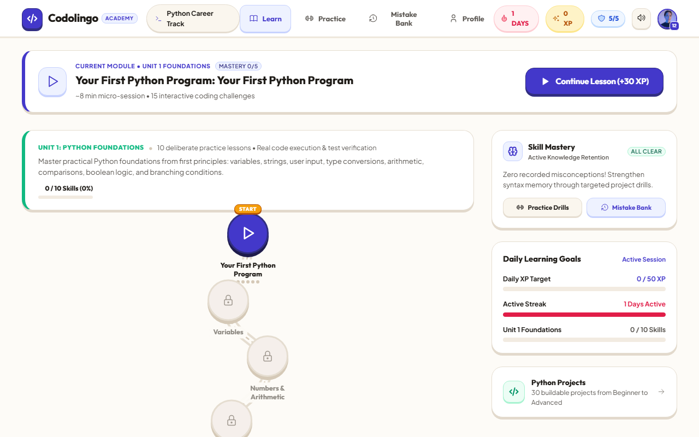

# Codolingo

> **Interactive Python mastery through deliberate practice.**  
> Learn → Code → Make Mistakes → Understand Why → Repair → Master.

Codolingo is a local-first, distraction-free educational web application built to teach Python from first principles to professional algorithmic thinking. It couples bite-sized micro-lessons with browser-native Python execution (WebAssembly via Pyodide), diagnostic misconception tracking, and an active **Fix-It Lab** that guides learners through 4-step repair drills whenever they make a mistake.

---

## Visual Showcase

| Learning Path | Interactive Lesson Runner |
|:---:|:---:|
|  |  |

| Fix-It Lab & Mistake Bank | Interactive Project Workspace |
|:---:|:---:|
|  |  |

| Practice Arena | Profile, Stats & Achievements |
|:---:|:---:|
|  |  |

---

## Key Features

- **Browser-Native Python Execution:** Runs real Python 3.12 code client-side inside a sandboxed Web Worker using Pyodide (WebAssembly). No backend servers, API keys, or cloud execution environments required.
- **Playable Units 1–6 (821 Audited Exercises):**
  - **Unit 1:** Python Foundations (Syntax, print, comments, execution model)
  - **Unit 2:** Variables & Data Types (Dynamic typing, integers, floats, booleans, casting)
  - **Unit 3:** Numbers & Arithmetic Operators (PEMDAS, integer division, modulo, exponents)
  - **Unit 4:** Strings & Basic Operations (Indexing, slicing, concatenation, methods)
  - **Unit 5:** Conditionals & Decision Making (if/elif/else, comparisons, boolean logic)
  - **Unit 6:** Loops & Repetition (while, for, range, break, continue, nested loops, guessing game project)
  - *Units 7–43 are clearly marked as roadmap / coming soon.*
- **Cognitive Mistake Bank & Fix-It Lab:**
  - Diagnoses errors against 13 categorized cognitive misconceptions (e.g., `OFF_BY_ONE`, `STRING_VS_NUMBER`, `LOOP_EXECUTION_CONFUSION`).
  - Standalone 4-step repair drills: **1. Spot It → 2. Understand Why → 3. Fix It → 4. Prove It**.
- **Deliberate Mastery Model:**
  - Skill mastery is dynamically computed from first-attempt accuracy, hints used, and mistake recurrence (0 to 5 pips).
  - Never hardcoded to 5 pips on first completion.
- **Local-First & Offline Ready:**
  - Progress, XP, streaks, levels, daily goals, and achievements persist entirely in `localStorage` (Schema v3).
  - Fully functional without an active internet connection.

---

## Tech Stack

| Layer | Technology |
|---|---|
| **Core Framework** | React 19 + TypeScript |
| **Build & Tooling** | Vite 8 + Rolldown bundler |
| **Code Execution** | Pyodide (Python 3.12 WebAssembly runtime in a Dedicated Web Worker) |
| **Code Editor** | Monaco Editor (`@monaco-editor/react`) |
| **Interactive Exercises** | `@dnd-kit` (Drag & drop code ordering), Tabler Icons |
| **Styling** | Vanilla CSS Design Tokens (HSL Palettes, Dark/Light modes, Glassmorphism) |
| **Quality & Testing** | Playwright, Axe-core (Accessibility audit), Node.js test runners |

---

## Getting Started

### Prerequisites

- [Node.js](https://nodejs.org/) version 20 or higher
- [npm](https://www.npmjs.com/) version 10 or higher

### Installation

```bash
# Clone the repository
git clone https://github.com/Ganesh-Kamath/Codolingo.git
cd Codolingo

# Install dependencies
npm install
```

### Running the Application

```bash
# Start the Vite development server
npm run dev
```

Open [http://localhost:5173](http://localhost:5173) in your browser.

### Building for Production

```bash
# Typecheck with TypeScript and compile production bundle
npm run build

# Preview the production build locally
npm run preview
```

---

## Validation & Automated Testing

Codolingo enforces strict quality gates to guarantee curriculum accuracy, Python assertion correctness, and progression integrity.

```bash
# Run the authoritative curriculum exercise quality gate (audits all 821 exercises in Units 1-6)
npm run validate

# Run the core regression and progression test suites
npm test

# Run the Playwright cross-browser and mobile responsive E2E suite
# (Note: Start a local server first, e.g., npx vite preview --port 3030)
npm run test:e2e
```

---

## Repository Structure

```
Codolingo/
├── .github/
│   └── workflows/
│       └── ci.yml               # GitHub Actions CI (build, validate, test on push)
├── docs/
│   ├── archive/                 # Historical audit reports (IMPLEMENTATION_AUDIT.md)
│   ├── screenshots/             # Showcase application screenshots
│   ├── CONTENT_GUIDE.md         # Exercise design principles & quality standards
│   └── CURRICULUM_MAP.md        # Syllabus specifications across Units 1–43
├── public/
│   ├── favicon.svg              # Brand icon
│   ├── manifest.webmanifest     # PWA manifest
│   └── pyodide/                 # Bundled WebAssembly binaries for offline execution
├── scripts/
│   ├── validate/                # Exercise auditors and schema validators
│   │   ├── validate-exercises.cjs   # Authoritative quality gate (npm run validate)
│   │   ├── validate-content.cjs     # Python runtime solution runner
│   │   └── validate-repair-content.cjs # 4-step repair drill auditor
│   ├── test/                    # Automated regression & integration test suites
│   │   ├── test-multi-unit-flow.cjs # Multi-unit playthrough & unlock simulation
│   │   ├── test-regression-suite.cjs# Core Python execution & progression assertions
│   │   ├── test-mastery-migration.cjs # Pip calibration & v3 migration tests
│   │   ├── test-lesson-resolution-index.cjs # Lesson ID resolution check
│   │   ├── test-block-type-renderers.cjs    # Block type renderer coverage check
│   │   └── test-playable-lessons-e2e.cjs    # Playwright E2E browser tests
│   ├── tools/                   # Developer utilities
│   │   ├── capture-deliverable-screenshots.cjs # Screenshot automation
│   │   ├── generate-python-course.cjs          # Curriculum code generator
│   │   └── run-axe-audit.cjs                   # WCAG accessibility auditor
│   └── README.md                # Comprehensive documentation of scripts
├── src/
│   ├── components/              # UI components (Path, Common, Navigation, Modals)
│   ├── constants/               # Mastery labels, levels, and app constants
│   ├── context/                 # AppContext (Progression, state, user profile)
│   ├── curriculum/              # Python curriculum definitions
│   │   └── python/
│   │       ├── content/         # JSON exercise candidate pools for Units 01–43
│   │       ├── foundations/     # Unit 1 TypeScript question definitions
│   │       ├── repair/          # 4-step repair drills for 13 misconception tags
│   │       ├── pythonCourse.ts  # Master course graph (units, skills, lessons)
│   │       └── curriculumStatus.json # Verified playable unit status manifest
│   ├── services/                # Pyodide worker, code execution, mastery, and progression
│   ├── views/                   # Route views (Learning Path, Lesson Runner, Review, Practice, Profile)
│   └── App.tsx                  # Root application router and shell
├── .env.example                 # Example configuration file
├── .gitignore                   # Ignore patterns for builds, runtime databases, and logs
├── package.json                 # Project dependencies and script commands
└── tsconfig.json                # TypeScript compiler configuration
```

---

## How to Add or Modify a Lesson

Codolingo lessons are authored using a **15-question session pool** designed to provide diverse pedagogical challenges:

1. **Locate or Create the Content File:**
   - Units 2–43 live in `src/curriculum/python/content/unit_XX/`.
   - Each lesson is a JSON file named after its ID and topic (e.g., `src/curriculum/python/content/unit_06/6.4_the_for_loop.json`).

2. **Structure the Lesson JSON:**
   ```json
   {
     "id": "6.4",
     "title": "The for Loop",
     "unit": "unit_06",
     "items": [
       {
         "id": "6.4_cand_1",
         "type": "micro_lesson",
         "title": "Iterating Over Sequences",
         "contentMarkdown": "# The for Loop\nIn Python, a `for` loop iterates over items..."
       },
       {
         "id": "6.4_cand_2",
         "type": "multiple_choice",
         "prompt": "What does a `for` loop in Python primarily do?",
         "options": [
           "Iterates over items in an iterable sequence",
           "Repeats indefinitely until memory is exhausted",
           "Compiles bytecode to machine language",
           "Defines a new variable scope"
         ],
         "correct_answer": "Iterates over items in an iterable sequence",
         "explanation": "A for loop steps through items in an iterable one by one."
       },
       {
         "id": "6.4_cand_3",
         "type": "write_the_code",
         "prompt": "Write a loop that prints the numbers 1, 2, and 3 using range(1, 4).",
         "starter_code": "for n in range(1, 4):\n    # print each number\n    pass",
         "solution_code": "for n in range(1, 4):\n    print(n)",
         "test_cases": [
           {
             "input": "",
             "expected_output": "1\n2\n3"
           }
         ],
         "misconception_tag": "OFF_BY_ONE"
       }
     ]
   }
   ```

3. **Follow Content Quality Guidelines:**
   - **Supported Exercise Types:** `micro_lesson`, `multiple_choice`, `output_prediction`, `fill_in_the_blank`, `write_the_code`, `fix_the_code`, `mini_challenge`, `trace_execution`, `code_ordering`.
   - **Taxonomy:** When tagging errors, use tags from the supported taxonomy in `src/curriculum/python/repair/` (`STRING_VS_NUMBER`, `ASSIGNMENT_VS_COMPARISON`, `OFF_BY_ONE`, `LOOP_EXECUTION_CONFUSION`, etc.).
   - **No Boilerplate:** Write realistic variable names (prices, scores, usernames, measurements) rather than generic `foo`/`bar`.

4. **Verify the Content:**
   ```bash
   # Run the exercise quality validator
   npm run validate

   # Ensure all automated test suites pass
   npm test
   ```

---

## Offline Architecture & Pyodide Binaries

Codolingo bundles Pyodide WebAssembly assets (`pyodide.asm.wasm`, `pyodide.asm.mjs`, `python_stdlib.zip`) directly inside `public/pyodide/`.

### Why are binaries committed in `public/pyodide/`?
- **True Offline Execution:** Zero dependency on remote CDNs (such as `cdn.jsdelivr.net`). Codolingo can be developed, tested, and used completely offline, on flights, or in restricted intranet environments.
- **Deterministic Reproducibility:** Eliminates version mismatches between npm package types and external CDN releases.
- **Instant First-Run:** New contributors clone the repository and run `npm run dev` with immediate working code execution—no extra download or post-install steps required.
- **Repository Health:** The entire bundled Pyodide directory is ~13.5 MB, well within standard Git file limits (far below GitHub's 100 MB per-file threshold).

---

## License

MIT © Ganesh Kamath
