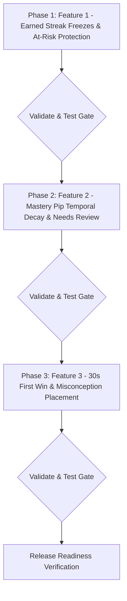

# Codolingo Learning Loop Implementation Plan

**Scope:** Phased execution blueprint for adapting Duolingo retention loops to Codolingo's local-first architecture (React 19 + TypeScript + Vite + Pyodide).  
**Constraint Invariant:** Local-first, backward-compatible localStorage schema v3 $\rightarrow$ v4 migration without loss of user progress. All changes flagged, small, and reversible.

---

## 1. Feature Ranking: Impact vs. Effort

| Rank | Feature | Learning Impact | Retention Impact | Implementation Effort | Recommended Phasing |
|:---:|:---|:---:|:---|:---:|:---:|
| **1** | **Earned Streak Freezes & At-Risk Protection** | High (Drives bug fixing) | **Critical** (Eliminates #1 churn driver) | **Medium** (2–3 days) | **Phase 1** |
| **2** | **Mastery Pip Temporal Decay & "Needs Review" Nodes** | **Critical** (True retention / SRS) | **High** (Drives ongoing path return) | **Medium** (2–3 days) | **Phase 2** |
| **3** | **30s First Win & Misconception Placement Engine** | **Critical** (Diagnoses root bugs) | **High** (Dramatically boosts Day-1 activation) | **Medium-Low** (1–2 days) | **Phase 3** |
| **4** | **Targeted Misconception Review Sessions** | High (Structured drills) | Medium (Enhances Practice Hub) | Medium (2 days) | Phase 4 |
| **5** | **In-Session Retry Queue for Missed Code Blocks** | High (Pedagogical guarantee) | Medium (Session satisfaction) | Medium (2 days) | Phase 5 |
| **6** | **Contextual Educational Web Notifications** | Medium (Requires browser permissions) | Medium (Tab re-engagement) | Medium (1–2 days) | Phase 6 |

---

## 2. Deep Technical Specifications for Top 3 Features

---

### Feature 1: Earned Streak Freezes & At-Risk Protection

#### Strategic Value
Solves the catastrophic "streak penalty trap" where a single missed day permanently demotivates a dedicated learner. Crucially, it links streak preservation directly to fixing real code bugs in Fix-It Lab.

#### Feature Flag
```typescript
export const FEATURE_STREAK_FREEZE_REPAIR = true;
```

#### Schema v4 Data Model Changes
Extend `UserProgressState` in `src/types/index.ts`:
```typescript
export interface UserProgressState {
  // Existing fields preserved...
  streak: number;
  bestStreak: number;
  
  // New Schema v4 Fields:
  freezeInventory: number;       // Current owned freezes (0, 1, or 2)
  freezeRepairsProgress: number; // 0, 1, or 2 (at 3, increments inventory & resets to 0)
  freezeUsedDates: string[];     // Dates where a freeze protected the streak
  lastActiveDate: string;        // Last calendar date with logged completion
  streakRescuePending?: boolean; // Set to true when a freeze was consumed overnight
}
```

#### Migration from v3 Schema in `migrationService.ts`
```typescript
// Inside migrateProgressData(raw, fallbackInitial):
migrated.freezeInventory = typeof raw.freezeInventory === 'number' 
  ? Math.min(2, Math.max(0, raw.freezeInventory)) 
  : (raw.streak >= 3 ? 1 : 0); // Grace grant 1 freeze to users with existing streaks >= 3

migrated.freezeRepairsProgress = typeof raw.freezeRepairsProgress === 'number'
  ? Math.min(2, Math.max(0, raw.freezeRepairsProgress))
  : 0;

migrated.freezeUsedDates = Array.isArray(raw.freezeUsedDates) ? [...raw.freezeUsedDates] : [];
migrated.lastActiveDate = raw.lastActiveDate || raw.activityHistory?.[raw.activityHistory.length - 1]?.date || '';
migrated.streakRescuePending = Boolean(raw.streakRescuePending);

migrated._version = 4;
```

#### Files to Modify / Create
1. `src/types/index.ts`: Declare new v4 fields on `UserProgressState`.
2. `src/services/migrationService.ts`: Upgrade `CURRENT_STORAGE_KEY = 'codolingo_progress_v4'`, add v3 $\rightarrow$ v4 migration logic.
3. `src/services/progressionService.ts`:
   - Implement `checkAndApplyStreakFreeze(state, todayStr)` called on app boot.
   - Implement `recordMistakeResolution(state)` that increments `freezeRepairsProgress` and grants freeze upon reaching 3.
4. `src/context/AppContext.tsx`: Expose `dismissStreakRescue()` and hook `resolveMistake()` to `recordMistakeResolution()`.
5. `src/views/DashboardView.tsx`: Render freeze snowflake indicator next to flame (`🔥 7  ❄️ 1/2`), and render "Streak at Risk" banner if hour $\ge 18$ and not yet practiced today.
6. `src/views/MistakeReviewView.tsx`: Render progress banner: *"Fix {3 - progress} more mistakes to earn a Streak Freeze ❄️"*.
7. `src/components/common/StreakRescueModal.tsx`: Visual modal displaying freeze activation animation when `streakRescuePending === true`.

#### Test Plan (`scripts/test/test-streak-freeze-mechanics.cjs`)
- **Test 1:** Missing 1 day with `freezeInventory = 1` consumes freeze, preserves streak, logs date in `freezeUsedDates`, and sets `streakRescuePending = true`.
- **Test 2:** Missing 1 day with `freezeInventory = 0` drops streak to 0/1 without crash.
- **Test 3:** Resolving 3 mistakes in Fix-It Lab increments `freezeInventory` by 1 and resets `freezeRepairsProgress` to 0.
- **Test 4:** Freezes cannot exceed max capacity of 2.
- **Test 5:** v3 schema migration smoothly seeds existing active users with 1 freeze if streak $\ge 3$.

#### Acceptance Criteria
- [ ] Streak never drops if a freeze is in inventory.
- [ ] Resolving 3 mistake drills increments freeze inventory and triggers celebration toast.
- [ ] Opening the app after a saved day shows the rescue modal with remaining inventory.
- [ ] Evening hours ($\ge 18:00$) display amber "At Risk" pulse on the streak badge.

---

### Feature 2: Mastery Pip Temporal Decay & "Needs Review" Path State

#### Strategic Value
Grounds Codolingo's progression in Settles & Meeder (2016) Half-Life Regression. Transforms a static completed course into an active retention loop where knowledge decays naturally and can be quickly refreshed.

#### Feature Flag
```typescript
export const FEATURE_MASTERY_DECAY = true;
```

#### Schema v4 Data Model Changes
Extend `UserProgressState` in `src/types/index.ts`:
```typescript
export interface SkillMasteryRecord {
  pips: number;              // Raw earned mastery pips (0 to 5)
  lastPracticedAt: string;   // ISO 8601 timestamp
  halfLifeDays: number;      // 7, 14, or 30 days based on tier
}

export interface UserProgressState {
  // Existing skillMastery: Record<string, number> preserved for backwards-compatibility
  skillMastery: Record<string, number>;
  // New granular temporal records:
  skillMasteryRecords: Record<string, SkillMasteryRecord>;
}
```

#### Decay Formula Implementation in `masteryService.ts`
```typescript
export const masteryService = {
  // ... existing methods ...

  getEffectivePips(record: SkillMasteryRecord, currentDate = new Date()): {
    effectivePips: number;
    decayed: boolean;
    daysSincePractice: number;
  } {
    if (!record || record.pips <= 0) {
      return { effectivePips: 0, decayed: false, daysSincePractice: 0 };
    }

    const lastDate = new Date(record.lastPracticedAt);
    const elapsedDays = Math.max(0, (currentDate.getTime() - lastDate.getTime()) / (1000 * 60 * 60 * 24));
    const halfLife = record.halfLifeDays || 14;

    // Settles & Meeder 2016 Half-Life Decay
    const decayFactor = Math.pow(2, -elapsedDays / halfLife);
    const calculatedPips = Math.round(record.pips * decayFactor);
    const effectivePips = Math.max(1, calculatedPips); // Never drop below 1 pip for completed skills

    return {
      effectivePips,
      decayed: effectivePips < record.pips || decayFactor < 0.70,
      daysSincePractice: Math.floor(elapsedDays)
    };
  }
};
```

#### Files to Modify / Create
1. `src/types/index.ts`: Declare `SkillMasteryRecord` and add `skillMasteryRecords` to `UserProgressState`.
2. `src/constants/mastery.ts`: Define half-life tier constants (`HALF_LIFE_TIERS = { LOW: 7, MID: 14, HIGH: 30 }`).
3. `src/services/masteryService.ts`: Implement `getEffectivePips()`, `refreshSkillMastery()`, and decay explanation generators.
4. `src/services/progressionService.ts`: Update `processLessonCompletion()` to stamp `lastPracticedAt: new Date().toISOString()`.
5. `src/components/path/LearningPath.tsx`:
   - Compute `decayed` state per skill node dynamically at render time.
   - For decayed nodes: apply pulsing amber ring (`var(--state-warning)`), display `Needs Review` chip, and offer 3-question Quick Refresh drill in modal.
6. `src/views/PracticeView.tsx`: Group all currently decayed skills into a prominent "Skills Needing Review" carousel at the top of the hub.

#### Test Plan (`scripts/test/test-mastery-decay-srs.cjs`)
- **Test 1:** Freshly completed skill (0 days elapsed) has `decayed = false` and retains 100% of earned pips.
- **Test 2:** 5-pip skill evaluated after 30 days (1 half-life) drops to 3 or 4 pips and enters `needs_review = true`.
- **Test 3:** Decayed skill never locks downstream skills that were previously unlocked.
- **Test 4:** Quick review completion resets `lastPracticedAt` to current timestamp and restores full 5 pips.
- **Test 5:** Legacy v3 migration correctly populates `skillMasteryRecords` from `skillMastery` with sensible fallback dates.

#### Acceptance Criteria
- [ ] Nodes older than their half-life show the amber "Needs Review" state on the learning path.
- [ ] Tapping a decaying node allows a fast 3-question refresh session.
- [ ] Completing the refresh restores full pips and logs timestamp.
- [ ] Downstream unlocked progression is never blocked by upstream decay.

---

### Feature 3: 30-Second First Win & Misconception-Driven Placement Engine

#### Strategic Value
Fixes the top of the funnel. Replaces generic survey drop-off with an instantaneous code execution victory (`print("Hello, World!")` in < 30s), followed by a diagnostic placement test that tests real code misconceptions (`ASSIGNMENT_VS_COMPARISON`, `STRING_VS_NUMBER`, `OFF_BY_ONE`) rather than multiple-choice trivia.

#### Feature Flag
```typescript
export const FEATURE_DIAGNOSTIC_ONBOARDING = true;
```

#### Schema v4 Data Model Changes
Extend `UserProgressState` in `src/types/index.ts`:
```typescript
export interface UserProgressState {
  // Existing fields...
  hasCompletedOnboarding: boolean;
  onboardingPlacementTier?: number; // 1 to 5
  diagnosedMisconceptions?: string[]; // Misconception tags detected during placement
}
```

#### Files to Modify / Create
1. `src/views/OnboardingView.tsx`:
   - **Screen 0 (Instant Sandbox):** Embedded Monaco/Code editor preloaded with `print("Hello, World!")`, real-time Pyodide runner, output console, and confetti burst. Time to run: ~15 seconds.
   - **Screen 1 (Track Selection):** *"Start from Absolute Scratch"* vs *"Test My Python Knowledge (2 mins)"*.
   - **Screen 2 (5-Tier Misconception Placement):** 5 progressive diagnostic challenges evaluating syntax, data types, equality vs assignment, loop bounds, and return values.
2. `src/services/placementDiagnosticService.ts` (NEW):
   - Maps responses and code submissions to canonical `MisconceptionTag` items.
   - Computes recommended unlock tier:
     - 0–1 correct: Unit 1
     - 2 correct: Unit 2
     - 3 correct: Unit 3
     - 4 correct: Unit 6
     - 5 correct: Unit 7+
3. `src/context/AppContext.tsx`: Expose `applyDiagnosticPlacementResult(tier, diagnosedTags)` which credits completed lessons, awards placement XP, and adds diagnosed tags directly into `mistakes[]`.

#### Test Plan (`scripts/test/test-diagnostic-onboarding.cjs`)
- **Test 1:** Running the 30-second sandbox outputs correctly to terminal and activates progression state.
- **Test 2:** Perfect score (5/5) in diagnostic placement unlocks Units 1 through 6 and credits appropriate base XP.
- **Test 3:** Failing Tier 3 (`ASSIGNMENT_VS_COMPARISON`) places learner in Unit 3 and logs the misconception to Fix-It Lab.
- **Test 4:** Brand-new learner choosing "Start from scratch" bypasses placement and launches Unit 1 Lesson 1.1 directly.

#### Acceptance Criteria
- [ ] New visitor can run real Python code within 30 seconds of opening the site.
- [ ] Placement test runs real execution checks and identifies specific code misconceptions.
- [ ] Completing placement unlocks the correct unit without manual page reload.
- [ ] Diagnosed misconceptions immediately appear in Fix-It Lab for subsequent practice.

---

## 3. Phased Implementation Roadmap



1. **Phase 1: Earned Streak Freezes & At-Risk Protection**
   - Branch: `feat/streak-freeze-protection`
   - Gate: `npm run build && npm run validate && npm test`
2. **Phase 2: Mastery Pip Temporal Decay & "Needs Review" State**
   - Branch: `feat/mastery-temporal-decay`
   - Gate: `npm run build && npm run validate && npm test`
3. **Phase 3: 30-Second First Win & Misconception Placement Engine**
   - Branch: `feat/diagnostic-onboarding-first-win`
   - Gate: `npm run build && npm run validate && npm test`

---

## 4. Next Step: Awaiting User Approval

Per instruction, **all code modifications and branch implementations are paused**. Execution will proceed with Phase 1 only upon explicit user review and approval of this plan.
